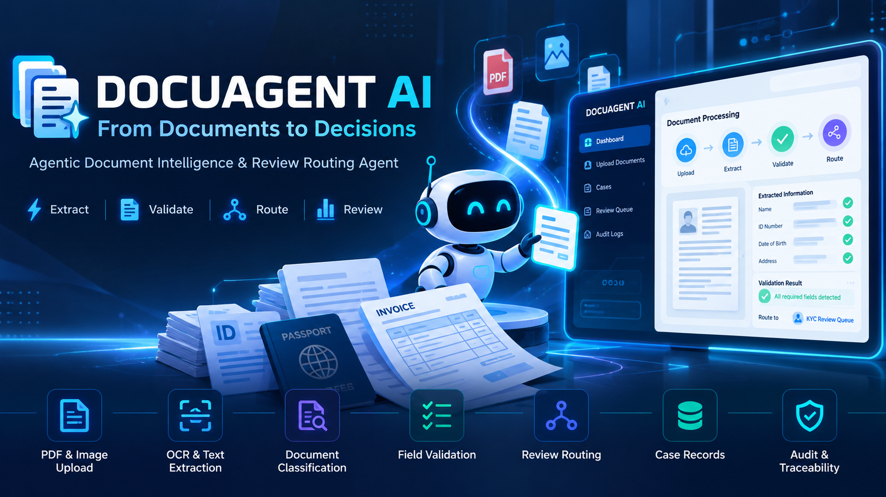

<p align="center">
  
</p>

# DOCUAGENT AI

### Agentic Document Intelligence & Review Routing Agent

DOCUAGENT AI is a document-processing and review-support prototype built for the **Innovation Ignite Symposium 2026 — Agentic Arena**. It is aligned with **Domain 01: Business & Productivity**, specifically **Document Processing & Extraction**.

The system is designed to help teams process uploaded documents by extracting text and fields, classifying document types, checking required information, identifying potential issues, and routing cases to an appropriate human-review queue.

> **Important:** DOCUAGENT AI is a decision-support prototype. Its extracted values and automated findings must be checked by an authorized human reviewer. Extraction performance depends on document quality, OCR availability, model/API configuration, and the document layout.

## Problem

Organizations often review documents manually because information must be extracted from different file formats, checked against required fields, and sent to the right reviewer. This work can be slow and can miss incomplete or inconsistent information.

## Proposed Solution

DOCUAGENT AI brings document ingestion, text extraction, classification, schema-based field extraction, rule-based validation, case routing, and audit logging into one review workflow. Instead of treating OCR as the end result, the workflow uses extracted information and validation findings to help determine the next review step.

## Main Workflow

1. **Upload** a supported PDF or image document.
2. **Extract text** using selectable PDF text when available, or an OCR path for scanned documents and images.
3. **Classify the document** using the filename, extracted text, and configured classification rules.
4. **Extract schema fields** relevant to the detected document type.
5. **Validate fields** against deterministic rules and identify missing required information or potential discrepancies.
6. **Route the case** to an appropriate review queue based on the findings.
7. **Review and audit** the extracted fields, validation findings, routing decision, and case events.

## Features

- PDF and image document intake.
- Selectable PDF text extraction where text is embedded in the PDF.
- OCR integration through the Google Gemini API and Tesseract.js fallback paths.
- Schema-based field extraction for supported document categories.
- Rule-based validation of required fields and other configured checks.
- Document classification and review-queue routing.
- Case records, processing summaries, and audit events.
- Human review support for missing, uncertain, or inconsistent information.

Features and results depend on the current configuration. Do not treat a field as accurate solely because the application provides a confidence score. Verify outputs with representative test documents.

## Technology Stack

| Area | Technology / component | Purpose |
|---|---|---|
| Frontend | React and TypeScript | User interface, document intake, dashboard, and review screens |
| Backend processing | TypeScript on Node.js | Coordinates extraction, validation, routing, and case processing |
| Multimodal extraction | Google Gemini API (`@google/genai`) | Document OCR and schema-guided extraction when API access is configured |
| Image OCR fallback | Tesseract.js | Local OCR fallback for supported raster images |
| PDF text extraction | `pdf-parse` | Reads selectable text from digital PDFs |
| Validation | Application rule engine | Checks required fields and produces validation findings |
| Case and audit handling | Application `caseStore` and audit-event structures | Holds case data and processing history; persistence depends on the configured store implementation |

The application code shown in this repository uses an application-level `caseStore`. This README does not assume a particular database engine unless one is explicitly configured elsewhere in the project.

## Repository Structure

```text
.
├── server/
│   ├── agent.ts             # Document processing and orchestration pipeline
│   ├── api.ts               # Backend API routes
│   ├── auth.ts              # Authentication-related logic
│   ├── fileValidation.ts    # Upload validation and filename handling
│   └── validators.ts        # Validation helpers
└── src/
    └── shared/              # Shared types, schemas, and validation logic
```

This is a high-level view of the main files referenced by the project. Additional frontend, configuration, and supporting files may exist in the repository.

## Setup

### Requirements

- Node.js and npm compatible with the project's `package.json`.
- A Google Gemini API key if Gemini-based OCR or summaries are enabled.

### Install dependencies

From the repository root, run:

```bash
npm install
```

### Configure the API key

Set `GEMINI_API_KEY` in the **backend/server environment**. Keep it out of frontend code, source control, screenshots, and public logs. Do not commit `.env` files containing secrets. If the project provides an `.env.example`, use it as the template for your local environment.

### Run the project

Use the scripts defined in the repository's `package.json`. For example, if a development script is defined, run:

```bash
npm run dev
```

If the repository separates frontend and backend commands, start each using the scripts documented in the relevant `package.json` or project configuration.

## Demonstration Guide

For a short prototype demonstration:

1. Open the DOCUAGENT AI dashboard.
2. Upload a clear sample PDF or image that you are permitted to use.
3. Show the detected document category and extracted schema fields.
4. Review validation findings, including any missing required information.
5. Show the resulting review queue and case audit events.
6. Compare the extracted values against the source document and explain any limitations observed.

Use sample or synthetic documents for demonstrations. Do not expose sensitive personal, financial, or confidential business information.

## Current Prototype Status

The project includes the workflow components for document ingestion, extraction, classification, validation, routing, case records, and audit events. OCR quality and schema extraction must be tested with representative PDFs and images before claiming production-grade accuracy. If text extraction fails or fields are incorrect, review the backend logs, API-key configuration, model configuration, and file data passed to the processing pipeline.

## Planned Improvements

- Improve extraction reliability across scans, image quality levels, and document layouts.
- Expand schema coverage and configurable validation rules.
- Improve handling of missing, ambiguous, and low-confidence values.
- Add or verify persistent database storage and retention controls.
- Add further integrations with document-management and enterprise workflows.
- Expand automated tests for PDF/image ingestion, extraction, validation, and routing.

These are planned improvements and should not be interpreted as already implemented features.

## Security and Responsible Use

- Keep API keys and credentials in server-side secrets.
- Restrict access to uploaded files and case records.
- Use only documents you are authorized to process.
- Avoid committing real user documents, secrets, or personal data to the repository.
- Treat model output as unverified and require human review for consequential decisions.
- Handle extraction failures transparently and do not infer fraud from a missing field or low confidence score.

## Competition Alignment

- **Event:** Innovation Ignite Symposium 2026 — Agentic Arena
- **Domain:** Business & Productivity
- **Subdomain:** Document Processing & Extraction
- **Project:** Agentic Document Intelligence & Review Routing Agent

The project demonstrates a multi-step workflow: it ingests documents, uses extraction tools, evaluates fields against rules, chooses a review route, and records the result. The prototype should be judged on its working end-to-end flow, tool usage, decision logic, error handling, and observable outputs—not just its user interface.

## Team

- **Team name:** Nexovant
- **Team members:** Nithin M, Pavan Kumar N
- **Institution:** Shridevi Institute of Engineering and Technology
- **Department:** Computer Science & Engineering

## License

Add the appropriate license before redistributing this project. Unless a license is included in the repository, no license should be assumed.
